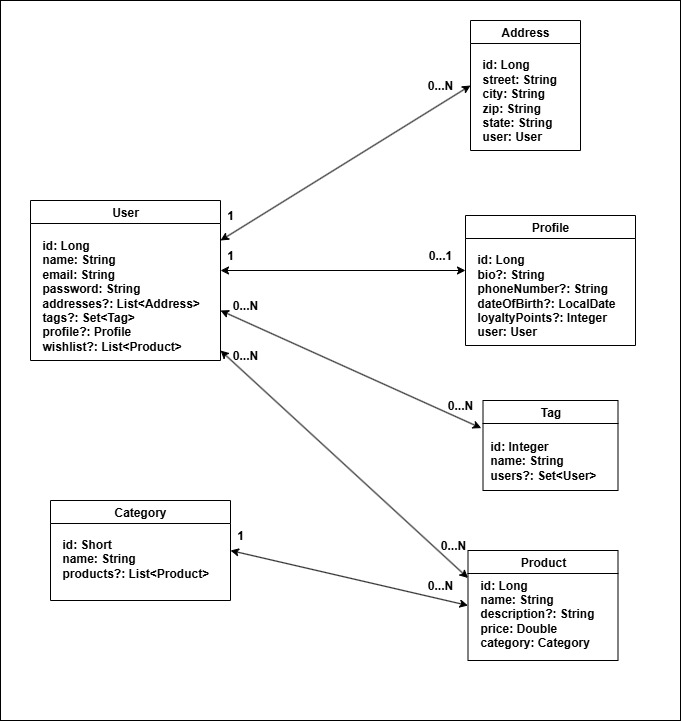

# Store

Store REST App


## Architecture Diagram:



## Steps to Setup:

1. Setup a Postgres DB.
2. Add the datasource in [application.yaml](src/main/resources/application.yaml).
3. Add db `url`, `user` and `password` in [flyway.conf](flyway.conf).
4. Use flyway maven plugin and run below commands to setup the tables:

```cmd
.\mvnw flyway:clean
```

```cmd
.\mvnw flyway:migrate
```